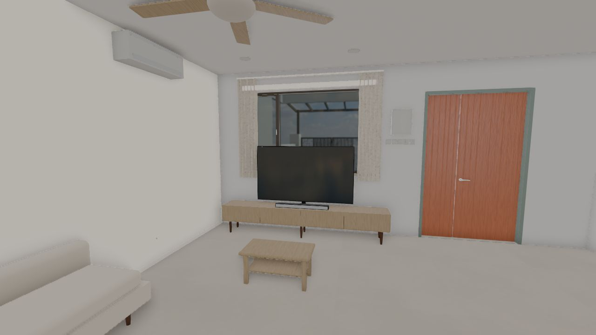
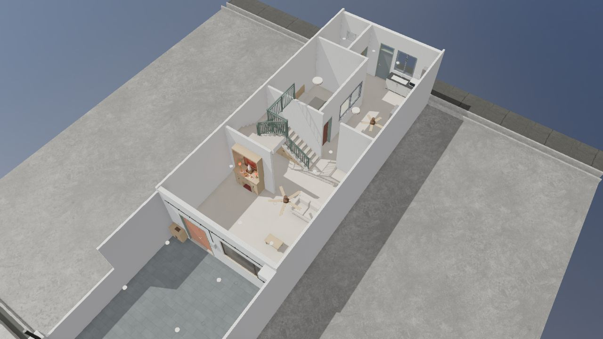

# RenOz

A **Three.js proof of concept** for building a 3D house and exploring renovation layouts and interior design in the browser.

[**Explore the live demo →**](https://ozoneio.github.io/RenOz/)

<p>
  
  
</p>

### Explore

- Compare the existing house with a renovated layout, extensions and awnings.
- Try Japanese, Scandinavian and soft grey interiors, or an unfurnished layout.
- Orbit, walk through rooms, open doors and windows, and measure distances.
- Preview daylight, interior lighting, floor plans and GPU path tracing.

### Run locally

Requires a current Node.js LTS release and pnpm.

```sh
pnpm install
pnpm dev
```

| Command | Purpose |
| --- | --- |
| `pnpm test` | Run regression tests |
| `pnpm build` | Type-check and build to `dist/` |
| `pnpm preview` | Preview the production build |
| `pnpm build:pages` | Rebuild `docs/` for GitHub Pages |

Built with **Three.js · TypeScript · Vite**. Photoreal mode uses `three-gpu-pathtracer` and benefits from a dedicated GPU.

This is a visualization experiment; dimensions and renovation details are illustrative.
